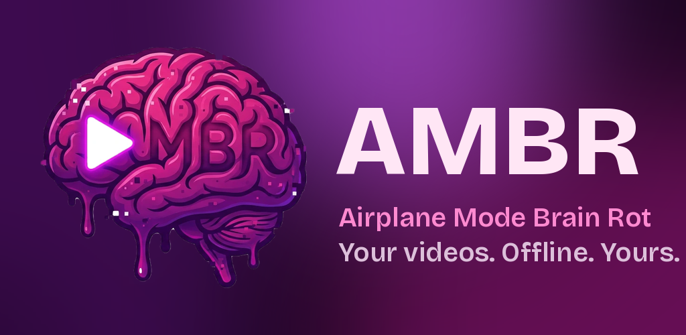
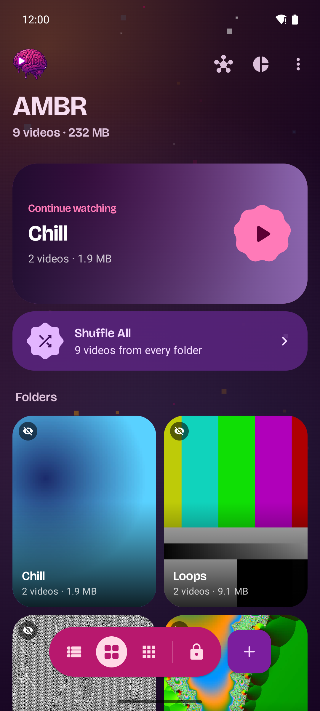
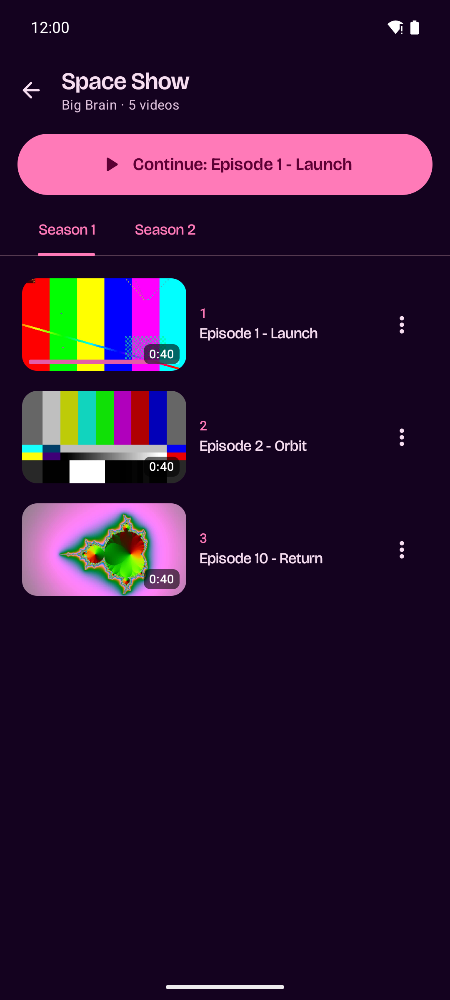
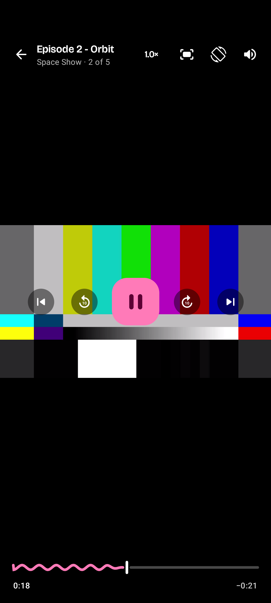
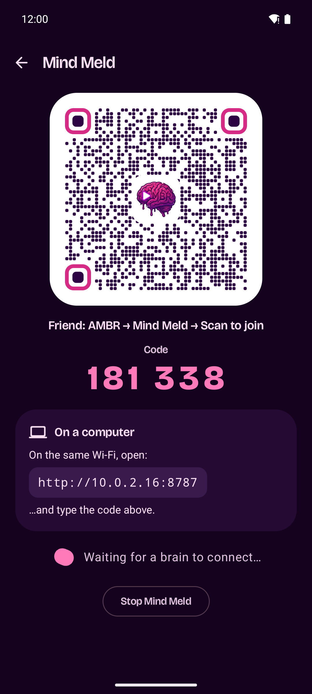

<p align="center">
  
</p>

<p align="center">
  <b>An offline, shuffle-everything player for your own short videos.</b><br>
  No accounts. No ads. No tracking. Just your folders, in a feed.
</p>

<p align="center">
  <a href="https://github.com/amruthwo/AMBR/releases/latest"></a>
  
  <a href="LICENSE"></a>
  <a href="https://hosted.weblate.org/engage/ambr/"></a>
</p>

---

## What is it?

**AMBR (Airplane Mode Brain Rot)** turns the videos already on your phone into a swipeable, shuffled feed, the way short-video apps work, except everything is yours and it all works offline. Put videos in `Internal storage/AMBR/` (one sub-folder per vibe), or add folders you already have (TV shows, Movies, Download, even on an SD card), open AMBR, and swipe.

<p align="center">
  
  
  
  
</p>

## Features

**Two ways to watch**
- 🧠🫠 **Brain Rot** (default): a shuffled, looping, swipeable feed for short videos, per folder or **Shuffle All**
- 🧠💡 **Big Brain** (long-press a folder): plays in order with full controls (previous/next, ±10s, speed, rotate). Sub-folders become seasons for shows and channels, and every video resumes where you left off

**Watch**
- Tap to mute · double-tap left/right to skip (keep tapping to skip further) · double-tap the middle to ❤️ favorite · hold for 2× · pinch to zoom
- Video size: Auto, Fit, Fill (crop), Stretch or Original
- **Search** every video; filter Brain Rot / Big Brain; sort by name, size or folder
- Material 3 Expressive design: squiggly progress bar, shape-morphing buttons, a background tinted by your thumbnails

**Organize**
- **Add folders from your phone** without copying them: TV and channel folders become shows with seasons; works on SD cards
- Folders as a list or 2- / 4-per-row grids; create, rename, move, delete, share
- **Hidden folders** behind a PIN or fingerprint, kept in app-private storage (screenshots blocked while unlocked)
- Keeps videos out of other gallery apps (`.nomedia`) by default, with per-folder overrides
- **Duplicate finder** and **Brain scan** (count, space, watch time, biggest videos)

**Cram Session**: shrink big videos to 480p / 720p / 1080p with your phone's hardware encoder. Queued, resumable, and an original is only deleted after its smaller copy is verified.

**Mind Meld**: swap videos and whole folders with a friend's AMBR, phone to phone, over the same Wi-Fi or a private hotspot, by scanning a QR code. No internet needed. On a computer, open the address shown and enter the code to stream, download (even whole folders as a zip) or drag-and-drop upload.

**Save to AMBR**: share a video or a link from any app. Links are downloaded in the background with [yt-dlp](https://github.com/yt-dlp/yt-dlp), with optional in-app sign-in for Reddit, Instagram and X.

## Install

Download the APK from the [latest release](https://github.com/amruthwo/AMBR/releases/latest):

| File | For |
|---|---|
| `AMBR-x.y.z-arm64.apk` | Almost every phone from the last ~8 years |
| `AMBR-x.y.z-armv7.apk` | Older 32-bit phones |
| `AMBR-x.y.z-lite.apk` | **AMBR Lite**: any phone, ≈5 MB, everything except link downloads |

### AMBR vs. AMBR Lite

| | AMBR | AMBR Lite |
|---|---|---|
| Feeds, Big Brain, folders, hidden folders, Mind Meld, Cram Session, search | ✅ | ✅ |
| Share video **files** to it from other apps | ✅ | ✅ |
| Download videos from **links** (YouTube, Reddit, Instagram, X…) | ✅ | ❌ |
| Size | ≈58 MB (bundles Python, yt-dlp, FFmpeg) | ≈5 MB |

AMBR Lite is a separate app (`com.ambr.reloaded.lite`), so you can install **both side by side**. Each keeps its own settings, favorites and hidden folders, and both read the same `AMBR` video folder. The F-Droid version will be AMBR Lite, because F-Droid doesn't allow the prebuilt binaries the link downloader needs.

**Automatic updates:** add AMBR to [Obtainium](https://github.com/ImranR98/Obtainium) and it installs new GitHub releases for you:

<a href="https://apps.obtainium.imranr.dev/redirect?r=obtainium://add/https://github.com/amruthwo/AMBR"></a>

An F-Droid version (AMBR Lite) is planned. Note: F-Droid signs apps with its own key, so you can't switch between the F-Droid and GitHub versions without reinstalling.

On first launch AMBR asks for **All files access**: it needs it to rename, move, hide and compress the videos in your `AMBR` folder and in folders you add. (On some phones, SD-card folders also need a one-time OK in Android's folder picker.) The internet is only used when you download from a link (or reach a Mind Meld partner on your network).

## Privacy

AMBR has no analytics, no ads and no accounts. Site sign-ins (for downloads) are stored only in AMBR's private storage on your phone. Hidden folders live in app-private storage. **Uninstalling AMBR deletes hidden folders**, so unhide anything you want to keep first.

## Build from source

Requirements: JDK 21, Android SDK with platform 37.

```bash
git clone https://github.com/amruthwo/AMBR.git
cd AMBR
./gradlew assembleFullDebug     # GitHub build  → app/build/outputs/apk/full/debug/
./gradlew assembleFdroidDebug   # lite / F-Droid → app/build/outputs/apk/fdroid/debug/
```

Release builds are signed from `keystore.properties` (git-ignored) or `AMBR_KEYSTORE_*` environment variables; without either, they're unsigned. See [docs/PUBLISHING.md](docs/PUBLISHING.md).

## Contributing & translations

Bug reports and ideas are welcome. Please use the [issue templates](https://github.com/amruthwo/AMBR/issues/new/choose). Pull requests too; see [CONTRIBUTING.md](CONTRIBUTING.md). Want AMBR in your language? Translate it in your browser on [Weblate](https://hosted.weblate.org/engage/ambr/). No coding needed.

## Credits

Made by [amruthwo](https://github.com/amruthwo), with thanks to **eskimogolfer**.

Built on the shoulders of:
[Seal](https://github.com/JunkFood02/Seal) (the share-to-download flow is modelled on it) ·
[youtubedl-android](https://github.com/JunkFood02/youtubedl-android) ·
[yt-dlp](https://github.com/yt-dlp/yt-dlp) ·
[FFmpeg](https://ffmpeg.org) ·
[AndroidX Media3](https://developer.android.com/media/media3) ·
[Coil](https://coil-kt.github.io/coil/) ·
[NanoHTTPD](https://github.com/NanoHttpd/nanohttpd) ·
[ZXing](https://github.com/zxing/zxing) ·
[CameraX](https://developer.android.com/media/camera/camerax) ·
[Bricolage Grotesque](https://fonts.google.com/specimen/Bricolage+Grotesque)

## License

[GPL-3.0](LICENSE). AMBR bundles GPL-3.0 components (youtubedl-android), so it is GPL-3.0 too.
